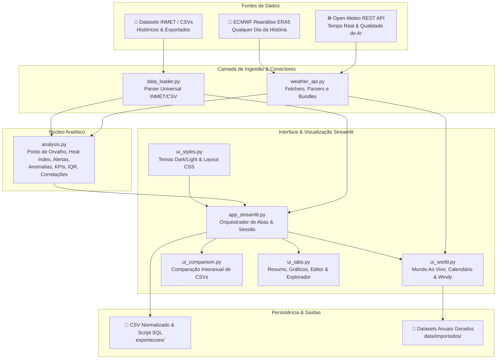

<div align="center">


<br>


<br>

**[🚀 QUICK START](#-quick-start)** &nbsp;·&nbsp; **[🐳 GUIA DE INSTALAÇÃO DO DOCKER](#-guia-completo-de-instalação-do-docker)** &nbsp;·&nbsp; **[⚡ RECURSOS](#-principais-recursos)** &nbsp;·&nbsp; **[🗂️ ABAS DO SISTEMA](#️-abas-do-sistema)** &nbsp;·&nbsp; **[🧱 ARQUITETURA](#-arquitetura-do-projeto)** &nbsp;·&nbsp; **[🧪 TESTES](#-testes-automatizados)**

<br>


</div>

<br>

## 🌐 O QUE É O CLIMAPS?

O **ClimaPS** é uma plataforma analítica meteorológica moderna, de alta performance e visualmente sofisticada, desenvolvida em **Python** e **Streamlit**. 

Projetada com foco em usabilidade, velocidade e precisão científica, a aplicação integra monitoramento em tempo real com análise forense de séries históricas:

1. **Monitoramento Global em Tempo Real:** Sem necessidade de cadastro, chaves ou configurações, consulte telemetria meteorológica de qualquer cidade ou coordenada do globo via API pública *Open-Meteo*, com radares ao vivo do *Windy.com*.
2. **Meteorologia Avançada & Índices Bioclimáticos:** Alertas barométricos de tempestade, cálculo do Ponto de Orvalho (*Dew Point*), Índice de Calor (*Heat Index*) e monitoramento contínuo da Qualidade do Ar e Queimadas (*US AQI*, PM2.5, PM10, CO).
3. **Calendário Histórico & Datasets Mundiais:** Consulte a telemetria horária de qualquer dia do passado via reanálise global ERA5 ou gere datasets anuais completos (8.760 horas) no mesmo formato do INMET para qualquer ponto da Terra.
4. **Comparação Interanual (CSV):** Confronte dois anos climáticos ou duas estações diferentes lado a lado, com gráficos interativos de deltas de chuva e amplitudes térmicas.
5. **Análise de Séries Históricas do INMET:** Importe séries horárias do INMET ou bases exportadas pelo sistema, aplique filtros de período e horário, audite a integridade dos dados e exporte em **CSV** ou scripts **SQL**.
6. **Design Adaptativo Duplo (Dark & Light Mode):** Interface profissional com contraste balanceado tanto no Modo Escuro nativo quanto no Modo Claro (*White Mode*).

---

## ⚡ PRINCIPAIS RECURSOS

<table>
<tr>
<td width="50%" valign="top">

### 🌍 TEMPO REAL & RADAR
- Consulta de clima por **nome de cidade** ou coordenadas (`Latitude` / `Longitude`).
- **Alertas de Tempestade**: monitoramento barométrico (< 1005 hPa), umidade e rajadas.
- **Índices Bioclimáticos**: Ponto de Orvalho (*Dew Point*) e Índice de Calor (*Heat Index* de Steadman/NOAA).
- **Qualidade do Ar & Queimadas**: monitoramento de PM2.5, PM10, CO e *US AQI*.
- **Radar Animado ao Vivo**: integração direta com o radar do **Windy.com**.
- **Previsão Estendida**: previsão horária (24h) e diária (7 a 14 dias).

</td>
<td width="50%" valign="top">

### 📅 CALENDÁRIO & 📂 SÉRIES GLOBAIS
- **Calendário Histórico**: consulte qualquer dia da história humana (reanálise global ERA5/Open-Meteo).
- **Gerador Anual (8.760h)**: baixe 1 ano completo de qualquer lugar do mundo no padrão exato do INMET.
- **Análise de Anomalias**: cruza a temperatura atual com a média histórica mensal da estação carregada.
- **Duelo e Comparação Global**: pódio de extremos e tabela comparativa multiparâmetros.
- **Carregamento Instantâneo**: carregue 30 dias recentes ou 1 ano inteiro direto nas abas analíticas.

</td>
</tr>
<tr>
<td width="50%" valign="top">

### ⚖️ COMPARAÇÃO ENTRE ANOS (CSV)
- **Comparação Interanual**: compare dois arquivos CSV (Ano A vs. Ano B) ou duas cidades distintas.
- **KPIs Consolidados**: precipitação acumulada, médias térmicas, recordes e dias com chuva.
- **Gráficos com Deltas**: barras mensais de chuva com variação e sobreposição de curvas térmicas.
- **Tabela Analítica**: matriz mensal detalhada com variação absoluta ($\Delta$) e percentual ($\%$).

</td>
<td width="50%" valign="top">

### 📊 ANÁLISE INMET & EXPORTAÇÃO
- Importa **CSV horário do INMET** e CSVs exportados pelo ClimaPS (com vírgula ou ponto-e-vírgula).
- Filtros por **período, horário e chuva**.
- Auditoria de qualidade (**buracos temporais, nulos, outliers por IQR e violações físicas**).
- **Matriz de correlação de Pearson** e insights automáticos.
- **Tabela editável** na sessão e exportação em **CSV** ou script **SQL** (`CREATE TABLE` + `INSERT INTO`).

</td>
</tr>
</table>

---

## 🚀 QUICK START

### 1. Clonar o Repositório

```bash
git clone https://github.com/Guilherme-Nepomuceno/CLIMAPS.git
cd CLIMAPS
```

### 2. Rodar via Docker (Recomendado)

Se você já possui o Docker instalado, basta executar:

```bash
docker compose up -d --build
```

👉 Acesse no seu navegador: **http://localhost:8501**

---

## 🐳 GUIA COMPLETO DE INSTALAÇÃO DO DOCKER

O Docker permite rodar o ClimaPS com todas as suas dependências em um contêiner isolado, garantindo execução idêntica em qualquer sistema operacional, sem necessidade de configurar ambientes virtuais Python manualmente.

### 🪟 Windows 10 e Windows 11

No Windows, a forma oficial e de melhor desempenho para usar o Docker é através do **Docker Desktop** integrado ao **WSL 2 (Subsistema do Windows para Linux)**.

#### Passo 1: Habilitar o WSL 2
1. Abra o **PowerShell** ou o **Terminal do Windows** como **Administrador** (clique com o botão direito e selecione *"Executar como administrador"*).
2. Execute o comando:
   ```powershell
   wsl --install
   ```
3. Se o WSL já estiver instalado, certifique-se de que está na versão 2:
   ```powershell
   wsl --set-default-version 2
   ```
4. **Reinicie o computador** para concluir a ativação dos recursos de virtualização do Windows.

#### Passo 2: Baixar e Instalar o Docker Desktop
1. Acesse o site oficial do Docker: [https://www.docker.com/products/docker-desktop/](https://www.docker.com/products/docker-desktop/)
2. Clique no botão **"Download for Windows"** para baixar o instalador (`Docker Desktop Installer.exe`).
3. Execute o instalador baixado.
4. Na tela de instalação, certifique-se de que a opção **"Use WSL 2 instead of Hyper-V (recommended)"** esteja **marcada**.
5. Conclua a instalação e reinicie o computador caso solicitado.

#### Passo 3: Iniciar e Validar o Docker
1. Abra o aplicativo **Docker Desktop** pelo Menu Iniciar e aguarde a inicialização (o ícone da baleia na barra de tarefas ficará estável).
2. Abra o **PowerShell** ou o **CMD** e teste a instalação:
   ```powershell
   docker --version
   docker compose version
   ```
3. Pronto! O Docker está pronto para uso no seu Windows.

---

### 🐧 Linux (Ubuntu, Debian, Pop!_OS, Mint e Derivados)

No Linux, a forma recomendada é instalar o **Docker Engine** nativo via repositório oficial da Docker.

#### Passo 1: Atualizar o Sistema e Remover Versões Antigas
Abra o seu terminal e execute:
```bash
sudo apt-get remove -y docker docker-engine docker.io containerd runc
sudo apt-get update
sudo apt-get install -y ca-certificates curl gnupg lsb-release
```

#### Passo 2: Adicionar a Chave GPG e o Repositório Oficial
```bash
# Cria o diretório de chaves se não existir
sudo install -m 0755 -d /etc/apt/keyrings

# Baixa a chave GPG oficial do Docker
curl -fsSL https://download.docker.com/linux/ubuntu/gpg | sudo gpg --dearmor -o /etc/apt/keyrings/docker.gpg
sudo chmod a+r /etc/apt/keyrings/docker.gpg

# Adiciona o repositório oficial às fontes do APT
echo \
  "deb [arch=$(dpkg --print-architecture) signed-by=/etc/apt/keyrings/docker.gpg] https://download.docker.com/linux/ubuntu \
  $(lsb_release -cs) stable" | sudo tee /etc/apt/sources.list.d/docker.list > /dev/null

sudo apt-get update
```
*(Se estiver usando Debian ou derivado, substitua `ubuntu` por `debian` na URL acima).*

#### Passo 3: Instalar o Docker Engine e o Docker Compose Plugin
```bash
sudo apt-get install -y docker-ce docker-ce-cli containerd.io docker-buildx-plugin docker-compose-plugin
```

#### Passo 4: Habilitar o Serviço e Configurar Permissões sem Sudo
Para não precisar digitar `sudo` em todos os comandos Docker:
```bash
# Inicia e habilita o serviço na inicialização do sistema
sudo systemctl enable --now docker

# Adiciona o seu usuário atual ao grupo docker
sudo usermod -aG docker $USER

# Aplica a permissão na sessão atual sem precisar deslogar
newgrp docker
```

#### Passo 5: Testar a Instalação
```bash
docker --version
docker compose version
docker run hello-world
```

<details>
<summary><b>📦 Fedora / RHEL / CentOS</b></summary>

```bash
sudo dnf -y install dnf-plugins-core
sudo dnf config-manager --add-repo https://download.docker.com/linux/fedora/docker-ce.repo
sudo dnf install -y docker-ce docker-ce-cli containerd.io docker-buildx-plugin docker-compose-plugin
sudo systemctl enable --now docker
sudo usermod -aG docker $USER
newgrp docker
```

</details>

<details>
<summary><b>📦 Arch Linux / Manjaro</b></summary>

```bash
sudo pacman -Syu --noconfirm docker docker-compose
sudo systemctl enable --now docker
sudo usermod -aG docker $USER
newgrp docker
```

</details>

---

### 🍎 macOS (Apple Silicon M1/M2/M3/M4 e Intel)

No macOS, utilize o **Docker Desktop para Mac**, que inclui o motor Docker, interface gráfica e o plugin Compose.

#### Passo 1: Baixar o Instalador
1. Acesse: [https://www.docker.com/products/docker-desktop/](https://www.docker.com/products/docker-desktop/)
2. Escolha a versão correspondente ao seu chip:
   - **"Mac with Apple Chip"**: para Macs com processadores **M1, M2, M3 ou M4**.
   - **"Mac with Intel Chip"**: para Macs mais antigos com processadores **Intel**.

#### Passo 2: Instalar
1. Abra o arquivo `.dmg` baixado.
2. Arraste o ícone do **Docker.app** para a pasta **Applications (Aplicativos)**.
3. Abra o **Docker** a partir da pasta de Aplicativos ou pelo Spotlight (`Cmd + Espaço`).
4. Aceite os termos de serviço e insira sua senha de administrador caso o macOS solicite permissões de virtualização.

#### Passo 3: Testar no Terminal
Abra o **Terminal** do macOS (`Cmd + Espaço` e digite `Terminal`):
```bash
docker --version
docker compose version
```

---

### 🚀 Rodando o ClimaPS com Docker

Com o Docker instalado em qualquer sistema (Windows, Linux ou macOS), clone o repositório e inicie o projeto:

```bash
# 1. Entre na pasta do projeto
cd CLIMAPS

# 2. Construa a imagem e inicie o contêiner em segundo plano
docker compose up -d --build
```

- Acesse a interface web em: **http://localhost:8501**
- Os dados baixados e exportados são sincronizados automaticamente em tempo real com as pastas locais `./data/importados` e `./exportacoes`.

<details>
<summary><b>🛠️ Comandos Úteis do Docker</b></summary>

```bash
# Ver logs da aplicação em tempo real
docker compose logs -f

# Parar o contêiner
docker compose down

# Executar a suíte de 20 testes unitários dentro do contêiner
docker compose run --rm climaps python -m unittest discover -s tests -v

# Reiniciar o contêiner após alterações
docker restart climaps-app
```

</details>

---

### 🐍 Instalação Local (Sem Docker)

Caso prefira rodar diretamente no seu ambiente Python (3.10+):

<details>
<summary><b>Instruções para Windows / Linux / macOS</b></summary>

```bash
# 1. Crie o ambiente virtual
python3 -m venv .venv

# 2. Ative o ambiente virtual
# No Windows (PowerShell):
.venv\Scripts\Activate.ps1
# No Linux / macOS:
source .venv/bin/activate

# 3. Instale as dependências
pip install --upgrade pip
pip install -r requirements.txt

# 4. Inicie o Streamlit
python -m streamlit run app_streamlit.py --server.port 8501
```

</details>

---

## 🗂️ ABAS DO SISTEMA

| Ícone | Nome da Aba | O Que Oferece |
|:---:|---|---|
| 🌍 | **Mundo Ao Vivo** | Clima em tempo real global, alertas barométricos de tempestade, Ponto de Orvalho, Índice de Calor, Qualidade do Ar (AQI/PM2.5/PM10/CO), Calendário Histórico (ERA5), download de 1 ano completo (8.760h), radar animado Windy.com, pódio de extremos e tabela comparativa mundial. |
| ⚖️ | **Comparação entre Anos (CSV)** | Confronto analítico direto entre dois anos (Ano A vs. Ano B) ou duas estações diferentes. KPIs anuais lado a lado, gráficos de barras com deltas de chuva, sobreposição de curvas térmicas e tabela de variações mensais ($\Delta$ e $\%$). |
| 📊 | **Resumo & Indicadores** | KPIs centrais da estação (total de medições, chuva acumulada, médias de $T_{\max}$ e $T_{\min}$, completude temporal), gráfico combinado de precipitação mensal e amplitude térmica, insights automatizados e diagnóstico rigoroso de qualidade de dados. |
| 📈 | **Gráficos & Tendências** | Gráfico de distribuição horária da chuva, curva contínua de amplitude térmica com preenchimento translúcido e matriz de correlação de Pearson com paleta de alta legibilidade. |
| 📋 | **Tabela de Dados** | Visualização interativa e edição direta de registros (chuva, $T_{\max}$, $T_{\min}$) na memória da sessão, permitindo correções pontuais antes da exportação. |
| 🔍 | **Explorador de Registros** | Inspeção detalhada de cada medição horária, respeitando os filtros ativos de período, janela horária e ocorrência de chuva. |
| 💾 | **Exportar** | Download imediato da base ativa em formato **CSV normalizado** ou script **SQL completo** (`CREATE TABLE` + `INSERT INTO`), com cópia de segurança salva automaticamente na pasta `exportacoes/`. |

---

## 🧱 ARQUITETURA DO PROJETO



### 📁 Estrutura de Arquivos

```text
.
├── app_streamlit.py              # Ponto de entrada e orquestrador das 7 abas do Streamlit
├── Dockerfile                    # Configuração da imagem de produção (Python 3.12-slim)
├── docker-compose.yml            # Orquestração com volumes persistentes para importações e exportações
├── .dockerignore                 # Arquivos excluídos do contexto do contêiner
├── .streamlit/
│   └── config.toml               # Configuração do tema base do Streamlit
├── climaps/
│   ├── __init__.py
│   ├── ui_styles.py              # Sistema de estilos adaptativo (Modo Claro & Modo Escuro)
│   ├── ui_world.py               # Aba Mundo Ao Vivo (API, Calendário ERA5, Anomalias e Windy)
│   ├── ui_comparison.py          # Aba Comparação entre Anos (Duelo de safras e séries CSV)
│   ├── ui_tabs.py                # Abas analíticas (Resumo, Gráficos, Tabela editável e Explorador)
│   └── core/
│       ├── __init__.py
│       ├── data_loader.py        # Ingestão universal de CSVs do INMET e exportações
│       ├── analysis.py           # Física atmosférica, KPIs, filtros, IQR e qualidade
│       └── weather_api.py        # Conectores com Open-Meteo, ERA5, Qualidade do Ar e Séries Anuais
├── data/
│   ├── dados_A101_H_2014.csv     # Dataset base de exemplo (Manaus A101 - 8.760 horas de 2014)
│   └── importados/               # CSVs importados e datasets de 1 ano baixados pela interface
├── exportacoes/                  # CSVs e scripts SQL gerados pelo usuário
├── tests/
│   ├── test_analysis.py          # 7 testes analíticos de integridade de dados e KPIs do INMET
│   └── test_ui_and_formatting.py # 13 testes de física atmosférica, API, ERA5, streams e comparação
├── dicionario.md                 # Dicionário didático completo do projeto para estudo acadêmico
├── requirements.txt              # Dependências estritas da aplicação
└── README.md
```

---

## 🧪 TESTES AUTOMATIZADOS

O ClimaPS possui uma suíte rigorosa de **20 testes unitários automatizados** implementados com o framework padrão `unittest` do Python, garantindo integridade matemática, física e operacional.

### Executando os Testes

**Via Docker:**
```bash
docker compose run --rm climaps python -m unittest discover -s tests -v
```

**Localmente:**
```bash
python -m unittest discover -s tests -v
```

<details>
<summary><b>📋 Lista dos 20 Testes Executados</b></summary>

1. `test_metadata_and_shape`: Extração de metadados e contagem exata das 8.760 horas anuais.
2. `test_missing_values`: Tratamento e conformidade de registros nulos.
3. `test_kpis`: Exatidão dos cálculos de chuva acumulada e médias térmicas.
4. `test_march_is_rainiest`: Validação estatística de março como o mês mais chuvoso da série padrão.
5. `test_filter_january_afternoon`: Combinação de filtros temporais e horários.
6. `test_quality_rules`: Diagnóstico de falhas de qualidade, buracos de série e outliers.
7. `test_complete_hourly_timeline`: Verificação de continuidade temporal sem lacunas.
8. `test_format_datetime_friendly`: Formatação humanizada de datas e horas.
9. `test_dew_point_calculation`: Validação do algoritmo de Magnus-Tetens para Ponto de Orvalho.
10. `test_heat_index_calculation`: Validação da equação multivariada do Heat Index (NOAA/Steadman).
11. `test_storm_risk_evaluation`: Validação do gatilho barométrico para detecção de tempestades.
12. `test_air_quality_and_uv_classification`: Classificação de faixas de poluição (AQI) e radiação UV.
13. `test_climate_anomaly_calculation`: Cálculo de anomalia relativa entre tempo real e médias históricas.
14. `test_parse_point_payload_with_forecast_and_indices`: Parser de payloads meteorológicos da API.
15. `test_load_exported_climaps_csv`: Ingestão de CSVs exportados com separador ponto-e-vírgula (`;`).
16. `test_load_exported_climaps_comma_csv`: Ingestão de CSVs exportados com separador vírgula (`,`).
17. `test_fetch_historical_day`: Consulta de dados de reanálise horária (ERA5) em datas históricas.
18. `test_fetch_annual_dataset_and_load_station_csv`: Ciclo completo de download de 1 ano e conversão em `StationDataset`.
19. `test_load_station_csv_from_bytes_and_stream`: Ingestão direta a partir de `bytes`, `StringIO` e `UploadedFile`.
20. `test_comparison_metadata_detection`: Identificação automática de safras e estações na aba de comparação.

</details>

---

<div align="center">


**PROJETO DESENVOLVIDO POR GUILHERME ALBUQUERQUE NEPOMUCENO**

[](https://linkedin.com/in/guilhermealbuquerquenepomuceno)
[](https://github.com/Guilherme-Nepomuceno)

⭐ Se este projeto foi útil para seus estudos ou pesquisas, considere deixar uma estrela no repositório!

<br>


</div>
