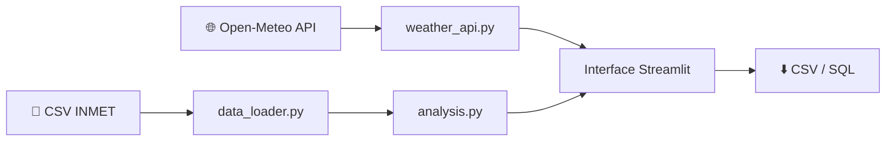

<div align="center">

# 🌦️ ClimaPS

### Telemetria climática global ao vivo + análise de dados do INMET

*Um painel escuro estilo "centro de controle" para quem curte dados, mapas e código limpo.*

<br>


<br>

[**🚀 Começar**](#-quick-start) · [**✨ Features**](#-features) · [**🗂️ Abas**](#️-abas-da-aplicação) · [**🧱 Arquitetura**](#-arquitetura) · [**🧪 Testes**](#-testes)

</div>

<!-- Dica: adicione aqui um GIF ou print do app.
<p align="center"></p>
-->

---

## 💡 O que é?

O **ClimaPS** abre já pronto para uso: sem CSV, sem chave de API, sem configuração. Digite uma cidade (ou coordenadas) e veja o clima do mundo em tempo real, com mapas interativos, radar animado e previsão de 7 dias.

Quer ir mais fundo? Importe séries horárias do **INMET**, filtre, edite, analise correlações e exporte tudo em **CSV** ou **SQL**.

> 🎓 Projeto didático: código organizado em módulos pequenos, fácil de ler e de evoluir.

---

## ✨ Features

| | Recurso | Detalhe |
|---|---|---|
| 🌍 | **Clima ao vivo** | Qualquer cidade/país ou `Latitude` / `Longitude` via Open-Meteo |
| 🗺️ | **Mapa global + radar** | Mapa interativo (Plotly) e radar animado (Windy.com) |
| 📆 | **Previsão de 7 dias** | Cards diários + gráfico combinado de temperatura e chuva |
| ⚔️ | **Duelo de cidades** | Compare duas cidades ao vivo e na curva térmica de 7 dias |
| 📥 | **Importação de CSV** | Arquivos horários do INMET, com cópia salva em `data/importados/` |
| 🔍 | **Filtros inteligentes** | Por período, faixa de horário e ocorrência de chuva |
| 📊 | **Análises automáticas** | KPIs, insights, resumo mensal, matriz de correlação e qualidade da base |
| ✏️ | **Editor em sessão** | Ajuste chuva, temperatura máxima e mínima direto na tabela |
| ⬇️ | **Exportação** | CSV e script SQL (`CREATE TABLE` + `INSERT`), completos ou filtrados |
| 🕒 | **Histórico de 30 dias** | Carregue os últimos 30 dias de qualquer cidade direto nas abas de análise |

---

## 🚀 Quick start

**1. Clone e entre na pasta**

```bash
git clone <url-do-repositorio>
cd climaps
```

**2. Crie o ambiente virtual e instale as dependências**

<details open>
<summary><b>🪟 Windows (PowerShell)</b></summary>

```powershell
py -m venv .venv
.venv\Scripts\activate
python -m pip install --upgrade pip
pip install -r requirements.txt
```

</details>

<details>
<summary><b>🐧 Linux / 🍎 macOS</b></summary>

```bash
python3 -m venv .venv
source .venv/bin/activate
python -m pip install --upgrade pip
pip install -r requirements.txt
```

</details>

**3. Rode o app**

```bash
python -m streamlit run app_streamlit.py --server.port 8501
```

Abra 👉 **http://localhost:8501** e pronto.

> 🌐 As consultas ao vivo precisam de internet (Open-Meteo e embed do Windy.com).

---

## 🗂️ Abas da aplicação

| Aba | O que você encontra |
|---|---|
| 🌍 **LIVE MUNDO** | Clima global ao vivo, cartão de telemetria, mapa Plotly/Windy, pódio de extremos e tabela comparativa |
| 📆 **PREVISÃO 7D** | Previsão diária em cards e gráfico combinado de temperatura e chuva |
| ⚔️ **DUELO** | Comparação ao vivo e curva térmica de 7 dias entre duas cidades |
| 📊 **RESUMO** | KPIs, insights automáticos, resumo mensal e qualidade da base |
| 📈 **GRÁFICOS** | Precipitação, amplitude térmica e matriz de correlação |
| ✏️ **EDITOR** | Tabela editável dos registros carregados na sessão |
| 🔍 **EXPLORADOR** | Visualização tabular conforme os filtros ativos |
| ⬇️ **EXPORTAR** | Download de CSV e SQL (e salvamento local em `exportacoes/`) |

---

## 📥 Analisando dados do INMET

1. Abra o app e use **Importar CSV** na barra lateral.
2. Escolha um arquivo `.csv` no padrão horário do INMET.
3. Aplique filtros de período, horário e chuva.
4. Explore **Resumo**, **Gráficos** e **Explorador**.
5. Ajuste valores no **Editor**, se necessário.
6. Exporte em **Exportar**.

> O CSV deve ter os metadados no início e uma tabela com data, hora, precipitação e temperaturas máxima/mínima. O `data_loader.py` normaliza nomes e tipos automaticamente.

📦 Já vem com um dataset de exemplo: `data/dados_A101_H_2014.csv` (Manaus A101, 2014).

---

## 🗄️ Exportação SQL

Gera um arquivo `.sql` com a tabela `observacoes_meteorologicas`:

```sql
DROP TABLE IF EXISTS observacoes_meteorologicas;
CREATE TABLE observacoes_meteorologicas (...);
INSERT INTO observacoes_meteorologicas (...) VALUES (...);
```

Os arquivos exportados ficam em `exportacoes/`.

---

## 🧱 Arquitetura



<details>
<summary><b>📁 Estrutura de pastas</b></summary>

```text
.
├── app_streamlit.py              # Interface principal em Streamlit
├── .streamlit/
│   └── config.toml               # Tema escuro padrão do ClimaPS
├── climaps/
│   ├── __init__.py
│   ├── ui_styles.py              # CSS, fontes, banner e faixa animada
│   ├── ui_world.py               # Aba Live Mundo (Open-Meteo, Plotly e Windy)
│   ├── ui_forecast.py            # Abas Previsão 7D e Duelo de Cidades
│   ├── ui_tabs.py                # Abas Resumo, Gráficos, Editor e Explorador
│   └── core/
│       ├── __init__.py
│       ├── data_loader.py        # Leitura e normalização do CSV do INMET
│       ├── analysis.py           # KPIs, resumos, filtros, insights e qualidade
│       └── weather_api.py        # Integração com a API pública Open-Meteo
├── data/
│   ├── dados_A101_H_2014.csv     # Exemplo de dataset (Manaus A101 - 2014)
│   └── importados/               # CSVs importados pela interface
├── exportacoes/                  # Arquivos CSV e SQL exportados
├── tests/
│   └── test_analysis.py          # Testes automatizados (unittest)
├── requirements.txt
└── README.md
```

</details>

---

## 🧪 Testes

```bash
python -m unittest discover -s tests -v
```

---

## 🛠️ Stack

`Python` · `Streamlit` · `Plotly` · `pandas` · `Open-Meteo` · `Windy.com` · `unittest`

---

<div align="center">

Feito com ☕ e dados por **Guilherme Albuquerque Nepomuceno**

[LinkedIn](https://linkedin.com/in/guilhermealbuquerquenepomuceno)

⭐ Se curtiu, deixa uma estrela no repositório!

</div>

