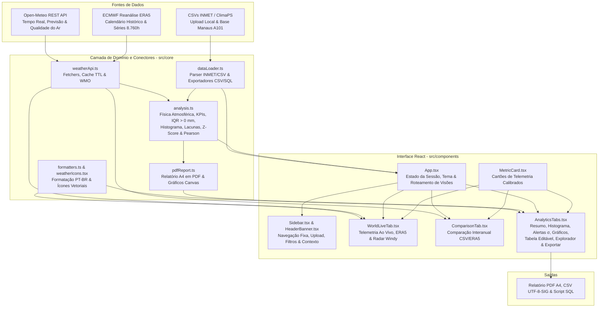

<div align="center">


<br>


<br>

**[🚀 QUICK START](#-quick-start)** &nbsp;·&nbsp; **[⚡ RECURSOS](#-principais-recursos)** &nbsp;·&nbsp; **[🗂️ VISÕES DO WORKSPACE](#️-visões-do-workspace)** &nbsp;·&nbsp; **[🎨 DESIGN SYSTEM](#-design-system--interface)** &nbsp;·&nbsp; **[🧱 ARQUITETURA](#-arquitetura-do-projeto)** &nbsp;·&nbsp; **[📘 DICIONÁRIO](./dicionario.md)**

<br>


</div>

<br>

## 🌐 O QUE É O CLIMAPS?

O **ClimaPS** é uma plataforma web moderna de telemetria meteorológica e análise forense de séries climáticas, desenvolvida em **React 19**, **TypeScript**, **Vite**, **Tailwind CSS v4** e **Recharts**.

Projetada com arquitetura de workspace analítico de alta precisão — inspirada em painéis de observatório e laboratórios climáticos — a aplicação integra monitoramento global em tempo real com auditoria de séries históricas do INMET diretamente no navegador, sem necessidade de chaves de API ou servidores dedicados:

1. **Monitoramento Global em Tempo Real:** Consulte telemetria meteorológica de qualquer cidade ou coordenada do planeta via API pública *Open-Meteo*, com radar animado ao vivo do *Windy.com*.
2. **Meteorologia Avançada & Índices Bioclimáticos:** Avaliação de risco barométrico de tempestade, cálculo do Ponto de Orvalho (*Dew Point* — Magnus-Tetens), Índice de Calor (*Heat Index* — NOAA/Steadman) e monitoramento da Qualidade do Ar (*US AQI*, PM2.5, PM10, CO, NO₂ e O₃).
3. **Calendário Histórico & Gerador de Séries Anuais (ERA5):** Inspecione a curva horária de qualquer dia do passado via reanálise global ECMWF ERA5 ou gere datasets anuais completos (8.760 horas) no padrão do INMET para qualquer coordenada da Terra.
4. **Comparação Interanual (CSV e ERA5):** Confronte dois anos climáticos ou duas estações diferentes lado a lado — via arquivos salvos, upload de CSV ou geração instantânea via ERA5 — com KPIs consolidados, deltas mensais de precipitação e curvas térmicas sobrepostas.
5. **Análise Forense do INMET, Monitoramento e Relatórios:** Importe CSVs horários do INMET ou bases exportadas pelo ClimaPS, aplique filtros de período e horário, visualize histograma de precipitação com densidade de extremos, acompanhe lacunas por coluna (destaque `> 10%`), monitore anomalias por desvio padrão ($z$-score) com badges de alerta na tabela e exporte em **PDF estruturado (A4)**, **CSV** ou **SQL**.
6. **Interface de Precisão em Modo Escuro & Claro:** Navegação lateral fixa, cabeçalho contextual, tipografia técnica com dígitos tabulares (`JetBrains Mono`) e alternância instantânea entre tema **Escuro** (observatório) e **Claro** (laboratório clínico).

---

## ⚡ PRINCIPAIS RECURSOS

<table>
<tr>
<td width="50%" valign="top">

### 🌍 TEMPO REAL & RADAR
- Busca por **nome de cidade** (geocodificação Open-Meteo) ou coordenadas (`Latitude` / `Longitude`).
- **Tendência Barométrica & Tempestades**: monitoramento de pressão (< 1005 hPa), umidade, vento e rajadas.
- **Índices Bioclimáticos**: Ponto de Orvalho (*Dew Point*) e Índice de Calor (*Heat Index* de Steadman/NOAA).
- **Qualidade do Ar & Queimadas**: monitoramento retrátil de *US AQI*, PM2.5, PM10, CO, NO₂ e O₃.
- **Radar Animado ao Vivo**: integração direta com camadas do **Windy.com** (chuva, vento, temperatura, nuvens e pressão).
- **Previsão Estendida**: previsão horária (24h) e diária (7 a 14 dias) com ícones vetoriais limpos.

</td>
<td width="50%" valign="top">

### 📅 CALENDÁRIO & 📂 SÉRIES GLOBAIS
- **Calendário Histórico**: consulte qualquer data do passado (reanálise global ERA5/Open-Meteo) com detalhamento de 24h.
- **Gerador Anual (8.760h)**: baixe 1 ano completo de qualquer ponto do globo no formato compatível com o INMET.
- **Análise de Anomalias**: cruza a temperatura atual com a média histórica mensal da estação ativa na sessão.
- **Monitoramento Global Comparativo**: resumo de extremos térmicos/pluviométricos e tabela comparativa multiparâmetros.
- **Carga Instantânea**: injete 30 dias recentes ou 1 ano inteiro diretamente nas abas de Análise Histórica.

</td>
</tr>
<tr>
<td width="50%" valign="top">

### ⚖️ COMPARAR ANOS (CSV / ERA5)
- **Múltiplas Origens**: compare arquivos salvos na sessão, uploads CSV ou séries anuais geradas sob demanda via ERA5.
- **KPIs Consolidados**: precipitação acumulada, médias térmicas, recordes, amplitude e dias com chuva.
- **Gráficos Interativos**: barras mensais de chuva lado a lado e sobreposição de curvas de temperatura máxima e mínima.
- **Matriz Analítica Mensal**: tabela alinhada com variação absoluta ($\Delta$) e percentual ($\%$) mês a mês.

</td>
<td width="50%" valign="top">

### 📊 ANÁLISE INMET, AUDITORIA & PDF
- Parser universal para **CSV horário do INMET** e CSVs exportados pelo ClimaPS (separadores `;` ou `,`).
- **Auditoria de Qualidade & Lacunas**: calcula `%` de nulos/`NaN` por coluna (destaque automático `> 10%`), lacunas temporais, violações físicas ($T_{\max} < T_{\min}$, chuva negativa e teto físico `> 150 mm/h`) e **IQR calibrado apenas sobre horas com chuva (`> 0 mm`)**.
- **Histograma de Precipitação & Extremos**: distribuição das horas chuvosas destacando a cauda extrema acima de $Q_3 + 1{,}5 \times \text{IQR}$ com zoom e alternância entre densidade (`%`) e frequência (`h`).
- **Monitoramento Climatológico ($\mu \pm k\sigma$)**: tabela paginada com badges visuais de alerta/crítico para registros fora dos limites históricos (`1,5σ` a `3,0σ`).
- **Exportação Completa**: gere **Relatórios Estruturados em PDF (A4)** com gráficos em alta resolução, além de **CSV (UTF-8-SIG)** e script **SQL** (`CREATE TABLE` + `INSERT INTO`).

</td>
</tr>
</table>

---

## 🚀 QUICK START

### Opção 1: Rodar via Docker (Recomendado)

Com o **Docker** instalado, clone o repositório e suba o contêiner com um único comando:

```bash
git clone https://github.com/Guilherme-Nepomuceno/CLIMAPS.git
cd CLIMAPS
docker compose up -d --build
```

👉 Acesse no navegador: **http://localhost:3000**

<details>
<summary><b>🛠️ Comandos úteis do Docker</b></summary>

```bash
# Acompanhar logs do contêiner
docker compose logs -f

# Parar e remover o contêiner
docker compose down
```

</details>

---

### Opção 2: Rodar Localmente (Node.js)

#### Pré-requisitos
- **Node.js 20+** (recomendado Node.js 22 LTS)
- **npm** (incluso no Node.js)

```bash
# 1. Clone o repositório
git clone https://github.com/Guilherme-Nepomuceno/CLIMAPS.git
cd CLIMAPS

# 2. Instale as dependências
npm install

# 3. Inicie o servidor de desenvolvimento
npm run dev
```

👉 Acesse no navegador: **http://localhost:3000**

### Scripts Disponíveis

| Comando | Descrição |
|---|---|
| `npm run dev` | Inicia o servidor Vite em modo de desenvolvimento na porta `3000` (`0.0.0.0`). |
| `npm run lint` | Executa verificação estrita de tipos TypeScript (`tsc --noEmit`). |
| `npm run build` | Compila e gera o bundle otimizado de produção em `dist/`. |
| `npm run preview` | Serve localmente o build de produção na porta `3000` para validação final. |

> **Sem chaves obrigatórias:** Todas as consultas de telemetria, geocodificação, qualidade do ar e reanálise histórica utilizam endpoints públicos da **Open-Meteo** diretamente pelo navegador. Veja `.env.example` para detalhes.

---

## 🗂️ VISÕES DO WORKSPACE

A navegação é organizada em dois grupos na barra lateral fixa:

### Monitoramento

| Visão | O Que Oferece |
|---|---|
| **Mundo Ao Vivo** | Painel principal de telemetria global em tempo real, tendência barométrica de tempestades, Ponto de Orvalho, Índice de Calor, Qualidade do Ar (*US AQI*, PM2.5, PM10, CO), previsão horária/diária, Calendário Histórico (ERA5), download/carga de 1 ano completo (8.760h), radar animado Windy.com, extremos globais e tabela comparativa mundial. |
| **Comparar Anos** | Confronto direto entre dois anos climáticos ou duas estações (via arquivos salvos, upload de CSV ou geração ERA5). Exibe KPIs comparativos, gráfico mensal de precipitação, curvas térmicas sobrepostas e matriz mensal de variações ($\Delta$ e $\%$). |

### Análise Histórica

| Visão | O Que Oferece |
|---|---|
| **Resumo e Qualidade** | KPIs centrais da estação, destaques automáticos, **Histograma de Precipitação e Densidade de Extremos** (IQR em horas chuvosas), **Dados Faltantes por Coluna** com destaque acima de `10%`, **Monitoramento de Limites Climatológicos** por desvio padrão ($z$-score) com badges de alerta na tabela, resumo mensal e auditoria de integridade física/temporal. |
| **Gráficos e Correlação** | Precipitação mensal e distribuição horária da chuva, curva contínua de amplitude térmica diária e matriz de correlação de Pearson entre variáveis climáticas. |
| **Tabela Editável** | Visualização e edição direta de células (`precipitacao_mm`, `temp_max_c`, `temp_min_c`) na sessão ativa para saneamento pontual antes da exportação. |
| **Explorador** | Inspeção detalhada e paginada dos registros horários filtrados, com busca textual e ordenação para auditoria linha a linha. |
| **Exportar CSV / SQL / PDF** | Geração de **Relatório Estruturado em PDF (A4)** com seções selecionáveis e gráficos em alta resolução, além de download imediato em **CSV normalizado** (`;` UTF-8-SIG), script **SQL** (`CREATE TABLE` + `INSERT INTO`) e salvamento de cópia na sessão. |

> **Base de Exemplo Inclusa:** Clique em **Abrir Manaus 2014** no cabeçalho superior (ou carregue `data/dados_A101_H_2014.csv` na barra lateral) para explorar imediatamente 8.760 horas de dados reais da estação INMET Manaus A101.

---

## 🎨 DESIGN SYSTEM & INTERFACE

A interface foi projetada com foco em densidade informacional, legibilidade científica e baixo ruído visual:

- **Sistema Tipográfico (2 + 1):**
  - **Display:** `Plus Jakarta Sans` para títulos e cabeçalhos.
  - **Interface:** `DM Sans` para rótulos, navegação e textos analíticos.
  - **Telemetria:** `JetBrains Mono` com `font-variant-numeric: tabular-nums` em todos os números, coordenadas, horários e colunas numéricas alinhadas à direita.
- **Dual-Theme Nativo (`Escuro` / `Claro`):**
  - Variáveis semânticas em `src/index.css` com `@custom-variant dark` do Tailwind CSS v4.
  - Superfícies com bordas sutis de precisão, controles segmentados, estados de carregamento em *skeleton* e ícones vetoriais (`lucide-react`).

---

## 🧱 ARQUITETURA DO PROJETO



### 📁 Estrutura de Arquivos

```text
.
├── Dockerfile                        # Build multi-stage (Node 22 Alpine -> Nginx 1.27 Alpine na porta 3000)
├── docker-compose.yml                # Orquestração rápida do contêiner CLIMAPS na porta 3000
├── nginx.conf                        # Configuração Nginx para SPA, gzip e cache de assets
├── .dockerignore                     # Exclusões do contexto de build Docker
├── index.html                        # Entrada HTML, fontes (Plus Jakarta Sans, DM Sans, JetBrains Mono) e metadados
├── package.json                      # Dependências e scripts Vite/TypeScript
├── vite.config.ts                    # Configuração do Vite + plugin Tailwind CSS v4
├── tsconfig.json                     # Configuração estrita do compilador TypeScript
├── .env.example                      # Documentação das variáveis de ambiente (endpoints públicos sem chave)
├── public/
│   └── data/
│       └── dados_A101_H_2014.csv     # Dataset de exemplo servido pela aplicação (Manaus A101 - 8.760h)
├── data/
│   └── dados_A101_H_2014.csv         # Cópia de referência do dataset base INMET
├── src/
│   ├── main.tsx                      # Bootstrap da árvore React
│   ├── index.css                     # Design tokens Light/Dark, utilitários de superfície, tabelas e animações
│   ├── App.tsx                       # Orquestrador da sessão, estado dos datasets, filtros, tema e notificações
│   ├── types/
│   │   └── weather.ts                # Interfaces TypeScript (WeatherRecord, KPIs, Histograma, Alertas σ, APIs)
│   ├── core/
│   │   ├── analysis.ts               # Física atmosférica, filtros, KPIs, IQR > 0 mm, histograma, lacunas, z-score e Pearson
│   │   ├── dataLoader.ts             # Parser universal INMET/CSV (com auditoria de colunas extras) e exportadores CSV/SQL
│   │   ├── pdfReport.ts              # Gerador de Relatório Estruturado em PDF (A4) com gráficos em Canvas de alta resolução
│   │   ├── weatherApi.ts             # Conectores Open-Meteo (Geocoding, Forecast, AQI, ERA5) + cache TTL
│   │   ├── formatters.ts             # Formatação PT-BR de números, datas e nomes seguros de arquivos
│   │   └── weatherIcons.tsx          # Mapeamento vetorial de condições climáticas WMO
│   └── components/
│       ├── Sidebar.tsx               # Barra lateral fixa (navegação, upload CSV, filtros e tema)
│       ├── HeaderBanner.tsx          # Cabeçalho contextual sticky com metadados da estação e CTA
│       ├── MetricCard.tsx            # Cartão de métrica científica com separação valor/unidade
│       ├── WorldLiveTab.tsx          # Monitoramento ao vivo, previsão, AQI, ERA5, radar Windy e tabela global
│       ├── ComparisonTab.tsx         # Comparação interanual entre arquivos CSV e séries ERA5
│       └── AnalyticsTabs.tsx         # Resumo, Histograma, Lacunas, Alertas σ, Gráficos, Tabela, Explorador e Exportar CSV/SQL/PDF
├── dicionario.md                     # Dicionário didático completo da arquitetura, código e meteorologia
└── README.md
```

---

## ✅ VERIFICAÇÃO DE QUALIDADE E BUILD

Antes de publicar ou abrir um Pull Request, valide a tipagem estrita e o build de produção:

```bash
# Checagem completa de tipos TypeScript (sem emitir arquivos)
npm run lint

# Build otimizado de produção via Vite
npm run build
```

---

<div align="center">


**PROJETO DESENVOLVIDO POR GUILHERME ALBUQUERQUE NEPOMUCENO**

[](https://linkedin.com/in/guilhermealbuquerquenepomuceno)
[](https://github.com/Guilherme-Nepomuceno)

⭐ Se este projeto foi útil para seus estudos ou pesquisas, considere deixar uma estrela no repositório!

<br>


</div>
