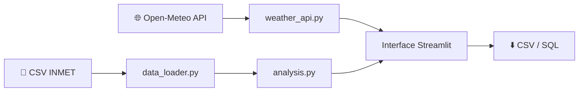

<div align="center">


<br>


<br>

**[🚀 QUICK START](#-quick-start)** &nbsp;·&nbsp; **[⚡ FEATURES](#-features)** &nbsp;·&nbsp; **[🗂️ ABAS](#️-abas)** &nbsp;·&nbsp; **[🧱 ARQUITETURA](#-arquitetura)** &nbsp;·&nbsp; **[🧪 TESTES](#-testes)**

<br>


</div>

<br>

## 🟡 O QUE É ISSO?

Um painel **escuro, rápido e sem burocracia** para ver o clima do planeta em tempo real.

Abriu o app? Já está funcionando. **Sem CSV. Sem chave de API. Sem configurar nada.**
Digite uma cidade (ou coordenadas) e pronto: mapa global, radar animado, previsão de 7 dias e duelo entre cidades.

E se você curte dados de verdade, importe séries horárias do **INMET**, filtre, edite, cruze variáveis e exporte em **CSV** ou **SQL**.

> 🎓 Projeto didático: módulos pequenos, código legível, fácil de estudar e de evoluir.

<br>

## ⚡ FEATURES

<table>
<tr>
<td width="50%" valign="top">

### 🌍 AO VIVO
- Clima de qualquer **cidade, país ou coordenada** (`Latitude` / `Longitude`)
- **Mapa global** interativo (Plotly)
- **Radar animado** (Windy.com)
- Pódio de extremos e tabela comparativa

</td>
<td width="50%" valign="top">

### 🔮 PREVISÃO & DUELO
- **7 dias** em cards + gráfico de temperatura e chuva
- **Duelo de cidades**: compare ao vivo e na curva térmica
- Carregue os **últimos 30 dias** de qualquer cidade direto nas abas de análise

</td>
</tr>
<tr>
<td width="50%" valign="top">

### 📊 ANÁLISE
- Importa **CSV horário do INMET**
- Filtros por **período, horário e chuva**
- KPIs, insights automáticos, resumo mensal
- **Matriz de correlação** e diagnóstico de qualidade

</td>
<td width="50%" valign="top">

### 🛠️ EDITAR & EXPORTAR
- Edite chuva, temp. máxima e mínima na sessão
- Exporte **CSV** ou script **SQL**
  (`CREATE TABLE` + `INSERT`)
- Dados completos ou só os filtrados

</td>
</tr>
</table>

<br>

## 🚀 QUICK START

```bash
git clone <url-do-repositorio>
cd climaps
```

<details open>
<summary><b>🪟 WINDOWS (PowerShell)</b></summary>

```powershell
py -m venv .venv
.venv\Scripts\activate
python -m pip install --upgrade pip
pip install -r requirements.txt
```

</details>

<details>
<summary><b>🐧 LINUX / 🍎 MACOS</b></summary>

```bash
python3 -m venv .venv
source .venv/bin/activate
python -m pip install --upgrade pip
pip install -r requirements.txt
```

</details>

**Rodar:**

```bash
python -m streamlit run app_streamlit.py --server.port 8501
```

👉 Abra **http://localhost:8501** e pronto.

> 🌐 As consultas ao vivo precisam de internet (Open-Meteo e embed do Windy.com).

<br>

## 🗂️ ABAS

| | ABA | O QUE TEM LÁ |
|:-:|---|---|
| 🌍 | **LIVE MUNDO** | Clima global ao vivo, cartão de telemetria, mapa Plotly/Windy, pódio de extremos, tabela comparativa |
| 📆 | **PREVISÃO 7D** | Cards diários + gráfico combinado de temperatura e chuva |
| ⚔️ | **DUELO** | Duas cidades frente a frente, ao vivo e na curva de 7 dias |
| 📊 | **RESUMO** | KPIs, insights automáticos, resumo mensal, qualidade da base |
| 📈 | **GRÁFICOS** | Precipitação, amplitude térmica, matriz de correlação |
| ✏️ | **EDITOR** | Tabela editável dos registros da sessão |
| 🔍 | **EXPLORADOR** | Registros em tabela, conforme os filtros ativos |
| ⬇️ | **EXPORTAR** | Download de CSV e SQL (e cópia local em `exportacoes/`) |

<br>

## 📥 ANALISANDO DADOS DO INMET

1. Abra o app e use **Importar CSV** na barra lateral
2. Escolha um `.csv` no padrão horário do INMET
3. Aplique filtros de período, horário e chuva
4. Explore **Resumo**, **Gráficos** e **Explorador**
5. Ajuste valores no **Editor**, se precisar
6. Exporte em **Exportar**

> O CSV precisa ter os metadados no início e uma tabela com data, hora, precipitação e temperaturas máxima/mínima. O `data_loader.py` normaliza nomes e tipos sozinho.

📦 Já vem com um dataset de exemplo: `data/dados_A101_H_2014.csv` (Manaus A101, 2014).
Arquivos importados ficam em `data/importados/`.

<br>

## 🗄️ EXPORTAÇÃO SQL

Gera um `.sql` com a tabela `observacoes_meteorologicas`:

```sql
DROP TABLE IF EXISTS observacoes_meteorologicas;
CREATE TABLE observacoes_meteorologicas (...);
INSERT INTO observacoes_meteorologicas (...) VALUES (...);
```

Os arquivos exportados ficam em `exportacoes/`.

<br>

## 🧱 ARQUITETURA



<details>
<summary><b>📁 ESTRUTURA DE PASTAS</b></summary>

```text
.
├── app_streamlit.py              # Interface principal em Streamlit
├── .streamlit/
│   └── config.toml               # Tema escuro padrão do ClimaPS
├── climaps/
│   ├── __init__.py
│   ├── ui_styles.py              # CSS, fontes, banner e faixa animada
│   ├── ui_world.py               # Aba Live Mundo (Open-Meteo, Plotly e Windy)
│   ├── ui_forecast.py            # Abas Previsão 7D e Duelo de Cidades
│   ├── ui_tabs.py                # Abas Resumo, Gráficos, Editor e Explorador
│   └── core/
│       ├── __init__.py
│       ├── data_loader.py        # Leitura e normalização do CSV do INMET
│       ├── analysis.py           # KPIs, resumos, filtros, insights e qualidade
│       └── weather_api.py        # Integração com a API pública Open-Meteo
├── data/
│   ├── dados_A101_H_2014.csv     # Exemplo de dataset (Manaus A101 - 2014)
│   └── importados/               # CSVs importados pela interface
├── docs/
│   ├── clima-mundo.gif           # Banner animado do README (mapa-múndi, chuva e raios)
│   └── divider.gif               # Divisor animado do README
├── exportacoes/                  # Arquivos CSV e SQL exportados
├── tests/
│   └── test_analysis.py          # Testes automatizados (unittest)
├── requirements.txt
└── README.md
```

</details>

<br>

## 🧪 TESTES

```bash
python -m unittest discover -s tests -v
```

<br>

<div align="center">


**FEITO COM ☕ E DADOS POR GUILHERME ALBUQUERQUE NEPOMUCENO**

[](https://linkedin.com/in/guilhermealbuquerquenepomuceno)

⭐ Curtiu? Deixa uma estrela no repositório!

</div>

</div>


